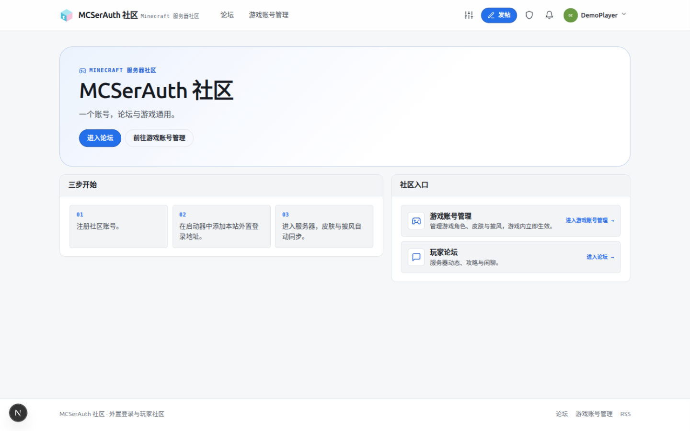
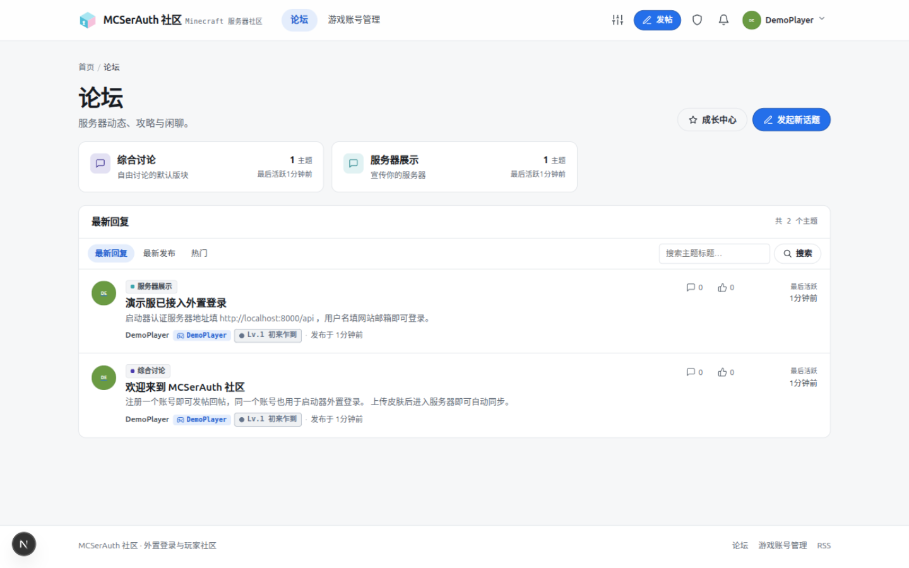
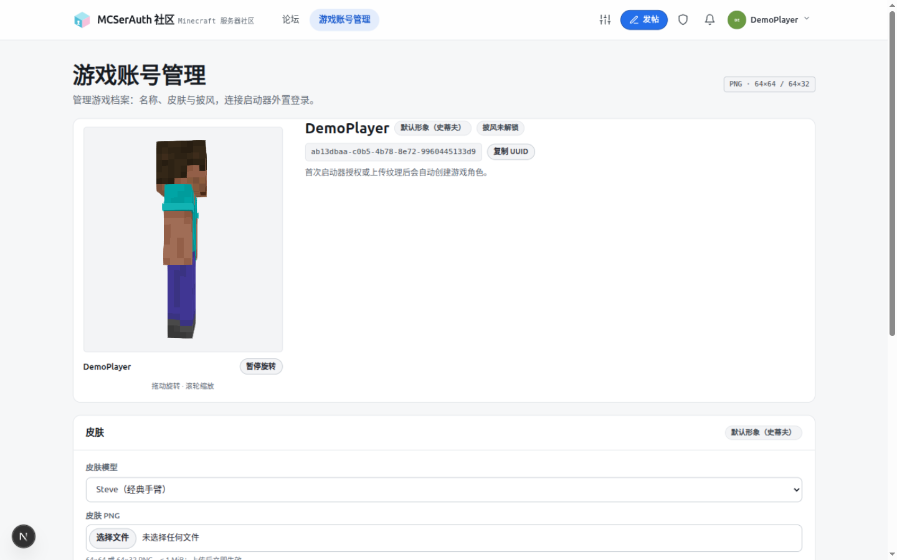
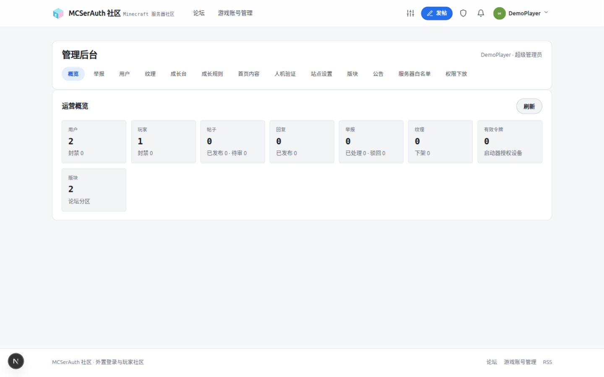
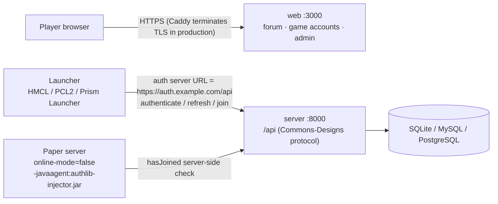

<div align="right">

[简体中文](README.md) | English

</div>

<div align="center">

# MCSerAuth

**An all-in-one community forum + external authentication service for third-party
Minecraft: Java Edition servers**

The auth side implements the Commons-Designs server protocol: HMCL / PCL2 /
Prism Launcher work out of the box with a single auth-server URL. The community
side provides a forum and player profiles. Both share the same account system,
deployed as a single unit; SQLite by default, with MySQL 8.0+ / PostgreSQL 16+
supported in production.

[](https://github.com/Logist1024/MCSerAuth/actions/workflows/ci.yml)
[](https://github.com/Logist1024/MCSerAuth/releases)
[](LICENSE)


| Home                                                                                      | Forum                                                                    |
| ----------------------------------------------------------------------------------------- | ------------------------------------------------------------------------ |
|                    |      |
| **Game account management** (skins/capes, signed in)                                      | **Admin console** (superadmin)                                           |
|  |  |

_Screenshots taken from a local `pnpm dev` instance (seed data + demo account)._

</div>

## Who this is for / who it is not for

**For you if:**

- You run a small-to-medium MC server and want the full loop "sign up → post on
  the forum → upload a skin → external login from the launcher → join the server";
- You have your own host (a Linux VPS or a Windows panel box) and a domain, and
  are willing to follow the deployment docs copy-paste-command by command;
- You want forum accounts and game external login to share one account system,
  so players handle password changes / resets / skins in exactly one place.

**Not for you if:**

- You want a Docker one-click deploy or a graphical installer — the project only
  ships a bare-metal runbook plus Caddy/pm2/cron/logrotate config examples (see
  [`docs/deploy.md`](docs/deploy.md));
- You need HD textures (4K skins) or rely on skin signature verification
  (`signaturePublickey`) — only vanilla-size textures are supported and this
  implementation provides no texture signatures (see
  [Known limitations](#known-limitations));
- You run a large community that needs multi-instance / clustered deployment —
  rate limiting, captcha and in-process caches are all in-memory and the system
  **must run as a single process** (see [`docs/deploy.md`](docs/deploy.md) §7).

## Why not an existing solution

- **Compared with other Commons-Designs implementations**: most open-source
  implementations are pure auth APIs / skin stations with no player community.
  MCSerAuth puts auth, player profiles and the forum into one account system —
  one deployment delivers both, and players only ever register once.
- **Compared with pointing your launcher at a public auth server**: that means
  your players' emails, passwords and skins live on someone else's machine, and
  you never own a community. Self-hosting MCSerAuth keeps account data, texture
  files and forum operation on your own server, and the launcher side needs no
  extra plugin (standard authlib-injector protocol).

## Topology



Plain-text version (for viewers outside GitHub):

```text
Player browser ──HTTPS(Caddy)──▶ web :3000    forum / game accounts / admin
Player launcher ──HTTPS(Caddy)──▶ server :8000 /api   auth server URL (metadata, authenticate, join)
Paper server ──HTTPS(Caddy)──▶ server :8000 /api    hasJoined check (online-mode=false + authlib-injector injected)
                                        └──▶ SQLite / MySQL / PostgreSQL
```

> Joining a server requires authlib-injector on **both** the client and the
> Paper side (server `online-mode=false` +
> `-javaagent:authlib-injector.jar=https://auth.example.com/api`). This
> repository ships no Paper plugin.

## Tech stack

| Layer    | Choice                                                                                                    |
| -------- | --------------------------------------------------------------------------------------------------------- |
| Runtime  | Node.js 22 LTS · pnpm 9 · TypeScript 6 (full-repo ESM)                                                    |
| Backend  | NestJS 12 · better-auth (accounts) · Drizzle ORM · SQLite / MySQL 8.0+ / PostgreSQL 16+                   |
| Frontend | Next.js 16 App Router · React 19 (rendering only — all business logic lives in the NestJS API)            |
| Contract | NestJS Swagger → `docs/openapi.json`; provisional protocol fields live in `packages/shared/src/protocol/` |
| Quality  | ESLint · Prettier · husky + lint-staged · GitHub Actions                                                  |

## Repository layout

```
MCSerAuth/
├── apps/
│   ├── server/              NestJS monolith backend
│   │   ├── src/config/      env loading + zod validation (single entry point)
│   │   ├── src/common/      filters/interceptors/pipes/log redaction/Swagger setup
│   │   ├── src/db/          Drizzle instance + single logical model + 3 generated schemas (31 tables)
│   │   ├── src/modules/     auth · session · profiles · forum · user · admin · site
│   │   │                    · growth · captcha · mail · maintenance · health
│   │   └── drizzle/         per-dialect migration SQL (sqlite/ · mysql/ · postgres/)
│   └── web/                 Next.js App Router (rendering layer)
├── packages/
│   └── shared/              cross-app types/DTOs/error codes/zod schemas (single source of truth)
├── deploy/                  production config examples: Caddy / pm2 / cron / logrotate
├── docs/                    deployment / database / OAuth integration guides + OpenAPI artifact
└── .github/workflows/ci.yml
```

## Before you deploy

> Skip this section for local experiments (dev defaults are fine);
> **go through every item before serving real players.**

**1. A domain and HTTPS are hard prerequisites, not nice-to-haves**

- Web session cookies are `HttpOnly / SameSite=Lax`, with `Secure` enabled by
  `COOKIE_SECURE` (`apps/server/src/modules/auth/auth.instance.ts`); in
  `NODE_ENV=production`, `COOKIE_SECURE=true` is a startup-enforced check — a
  misconfigured process refuses to start (`apps/server/src/config/env.ts`).
  Production therefore **requires HTTPS**: a domain + TLS-terminating reverse
  proxy (`deploy/Caddyfile` is a ready example and issues Let's Encrypt
  certificates automatically).
- `APP_URL` (site) and `AUTH_URL` (auth) must belong to the **same registrable
  domain** (e.g. `example.com` + `auth.example.com`), otherwise better-auth's
  Lax cookies are not sent cross-site — the symptom is "login succeeds but every
  API call returns 401". Production also **rejects loopback addresses**
  (localhost/127.0.0.1) at startup, because verification emails would generate
  unopenable links.
- Serving the public internet from mainland China requires an ICP-filed domain.
  That is a property of the deployment environment, not this codebase — but it
  decides whether ports 80/443 can be opened at all.

**2. Minimum production changes (full checklist in [`docs/deploy.md`](docs/deploy.md) §3)**

| Variable             | Value                                            | If you skip it                                                                                                                                          |
| -------------------- | ------------------------------------------------ | ------------------------------------------------------------------------------------------------------------------------------------------------------- |
| `BETTER_AUTH_SECRET` | `openssl rand -base64 48`                        | production refuses to start on the dev default; it also encrypts stored SMTP passwords                                                                  |
| `COOKIE_SECURE`      | `true`                                           | production startup fails                                                                                                                                |
| `APP_URL`/`AUTH_URL` | two real https origins (same registrable domain) | loopback origins fail startup; cross-domain cookies break                                                                                               |
| `CONSOLE_KEY`        | `openssl rand -base64 32`, or leave empty        | empty disables `/console` (recommended until needed)                                                                                                    |
| `MAIL_PROVIDER`      | explicitly set `smtp`                            | **filling in `SMTP_*` does not switch the mail transport**; the default `console` provider only logs emails, so players never receive verification mail |

**3. You are hosting your players' emails and passwords**

Once deployed, players' emails, password hashes and skin files all live on
**your server**. Passwords are stored hashed by better-auth (plaintext is never
visible), but the physical security and access control of the database file,
the upload directory and your backups are entirely the operator's
responsibility — a compromised server, leaked backup or misconfigured panel is
on you. Before going live, at minimum: strong credentials, regular
`pnpm db:backup` with backups stored safely, database/upload directories never
exposed publicly, and vulnerabilities handled per [`SECURITY.md`](SECURITY.md).
For players, state plainly in a forum announcement or terms of service where
their data lives and what a breach would mean.

## Quick start

Requires Node.js 22 (pinned in `.nvmrc`) and pnpm via corepack.

```bash
git clone https://github.com/Logist1024/MCSerAuth.git && cd MCSerAuth
corepack enable                 # or use corepack pnpm <cmd>
pnpm install
cp .env.example apps/server/.env   # optional: dev defaults work without it
pnpm db:migrate                    # create DB + apply all migrations (dialect picked from DATABASE_URL)
pnpm dev                           # server on :8000, web on :3000
```

Once running:

| URL                                                    | What it is                                                  |
| ------------------------------------------------------ | ----------------------------------------------------------- |
| <http://localhost:3000>                                | Server home page (forum / game accounts entry)              |
| <http://localhost:3000/forum>                          | Forum (categories, threads, sort/search, post, reply, like) |
| <http://localhost:3000/textures>                       | Game account management (profile / skins / capes / guide)   |
| <http://localhost:3000/admin>                          | Admin console (reviewer / admin / superadmin)               |
| <http://localhost:3000/sitemap.xml> / `/forum/rss.xml` | SEO & RSS                                                   |
| <http://localhost:8000/health>                         | Health check (unified `{code:0,data}` envelope)             |
| <http://localhost:8000/health/live> · `/health/ready`  | liveness (process) · readiness (503 when DB is down)        |
| <http://localhost:8000/docs>                           | Swagger UI (full endpoint contract)                         |
| <http://localhost:8000/docs/json>                      | OpenAPI JSON                                                |

Smoke test (sign-up → session):

```bash
curl -c jar.txt -X POST http://localhost:8000/api/auth/sign-up/email \
  -H 'Content-Type: application/json' \
  -d '{"email":"a@example.com","password":"S3cure!Passw0rd","name":"Tester"}'
curl -b jar.txt http://localhost:8000/api/auth/get-session
```

## Feature map

The full feature list (with implementation locations and API paths) lives in
**[`docs/features.md`](docs/features.md)**:

| Feature               | Summary                                                                                               | More                               |
| --------------------- | ----------------------------------------------------------------------------------------------------- | ---------------------------------- |
| Accounts & auth flow  | better-auth web sessions + OAuth authorization code/PKCE (basic/player/email scopes) + password reset | [features.md §1](docs/features.md) |
| Session service       | `joinServer` / `hasJoined`, server allow-list registration, profile lookup                            | [features.md §2](docs/features.md) |
| Skins & capes         | vanilla-size PNG uploads effective immediately, 3D preview, short-lived signed URLs, post-moderation  | [features.md §3](docs/features.md) |
| Launcher direct login | HMCL / PCL2 / XMCL log in with the API root URL + site email (Yggdrasil protocol)                     | [features.md §4](docs/features.md) |
| Forum                 | categories / threads / replies / likes / notifications / reports / images / guest browsing            | [features.md §5](docs/features.md) |
| Management & roles    | four roles + 9 delegable capabilities + `/console` key-protected super console + site appearance      | [features.md §5](docs/features.md) |
| Community growth      | levels / titles / check-ins / points / shop / tipping / home banners                                  | [features.md §6](docs/features.md) |
| Captcha               | built-in SVG arithmetic or Cloudflare Turnstile / hCaptcha, on by default in production               | [features.md §6](docs/features.md) |

## Known limitations

Listed as the current implementation actually behaves; parenthesized locations
are verifiable in source.

**Protocol & joining**

1. `/api/sessionserver/*` (the authlib-injector compatibility layer) accepts
   **any handshake hash** per Yggdrasil semantics, without a server allow-list;
   only the native `/api/session/*` requires an admin-registered `serverId`
   (`yggdrasil-session.controller.ts` passes `enforceServerWhitelist: false`;
   `assertServerAllowed` in `session.service.ts`).
2. The metadata **does not provide `signaturePublickey`** (`metadata()` in
   `yggdrasil.service.ts`); texture properties carry no Yggdrasil signature.
   Third-party tools that depend on signature verification may not work.
3. **No Paper plugin ships in this repository** — joining requires
   authlib-injector injected on both the client and Paper
   (`online-mode=false` + `-javaagent`), see [Topology](#topology).

**Accounts & textures**

4. One account maps to exactly one game identity: the account↔player relation
   is strictly 1:1 (`ensurePlayerForUser` in `oauth.service.ts`); multiple
   characters per account are not supported.
5. Only vanilla-size textures: skins 64×32 / 64×64, capes 64×32, ≤ 1 MiB,
   validated with `sharp`; HD textures are rejected outright (`ALLOWED_DIMENSIONS`
   / `assertValidPng` in `texture.service.ts`).
6. Cape uploads require the points-shop unlock first and return 403 otherwise
   (`assertCapeUnlocked` in `xp.service.ts`); skins are unaffected.
7. Sign-in is **email + password only** (better-auth `emailAndPassword`; no
   social login providers are configured); in launcher direct login the
   "username" is the website email.

**Operations**

8. Rate limiting, captcha and in-process caches are **in-memory and single-process
   only**; pm2 cluster or multiple instances dilute rate-limit thresholds by the
   process count and break one-time captcha tokens across processes
   (`deploy/ecosystem.config.cjs` comments, [`docs/deploy.md`](docs/deploy.md) §7).
9. The player-facing "authorized devices" page and `/api/user/tokens` were
   **removed on 2026-10-25**; the only launcher-token revocation entry point is
   the launcher-side `POST /api/authserver/invalidate`.
10. There is no long-running demo site; all README screenshots come from a
    local `pnpm dev` instance.

## Common commands

Run from the repo root (`package.json` → `scripts`):

| Command                             | What it does                                                 |
| ----------------------------------- | ------------------------------------------------------------ |
| `pnpm dev`                          | Start server + web in parallel (builds shared first)         |
| `pnpm build`                        | Full build: shared → server → web                            |
| `pnpm lint` / `pnpm lint:fix`       | Repo-wide ESLint                                             |
| `pnpm format` / `pnpm format:check` | Prettier                                                     |
| `pnpm typecheck`                    | Repo-wide `tsc --noEmit`                                     |
| `pnpm test` / `pnpm test:coverage`  | Vitest (server + web)                                        |
| `pnpm db:generate`                  | Generate 3 schemas + SQLite/MySQL/PG migrations              |
| `pnpm db:generate:sqlite`           | Generate SQLite migration only                               |
| `pnpm db:check`                     | Verify generated schemas match `model.ts` (CI)               |
| `pnpm db:migrate`                   | Apply migrations for the dialect chosen by `DATABASE_URL`    |
| `pnpm db:seed`                      | Idempotently seed placeholder user/categories/site settings  |
| `pnpm db:copy-data`                 | One-shot cross-dialect data copy (SQLite targets included)   |
| `pnpm db:backup`                    | Back up the current DB (all dialects; `--dry-run` prints it) |
| `pnpm db:studio`                    | Browse data in Drizzle Studio                                |
| `pnpm admin:grant <email> [role]`   | Grant user/reviewer/admin/superadmin                         |
| `pnpm openapi:export`               | Build and refresh `docs/openapi.json`                        |

## Environment variables

All variables are zod-validated in `apps/server/src/config/env.ts` — startup
fails fast, with no runtime fallbacks. Template: root
[`.env.example`](.env.example) (copy to `apps/server/.env`).

| Variable                          | Default (dev)                     | Description                                                       |
| --------------------------------- | --------------------------------- | ----------------------------------------------------------------- |
| `NODE_ENV`                        | `development`                     | `production` enforces secret & cookie validation                  |
| `PORT`                            | `8000`                            | server port                                                       |
| `LOG_LEVEL`                       | `debug` (template)                | pino level; sensitive fields auto-redacted                        |
| `APP_URL` / `AUTH_URL`            | `http://localhost:3000` / `:8000` | site origin / auth origin; CORS & OriginGuard allow-list sources  |
| `COOKIE_SECURE`                   | `false`                           | must be `true` in production (Secure/HttpOnly/SameSite=Lax)       |
| `BETTER_AUTH_SECRET`              | dev default                       | required in production (≥32 chars), `openssl rand -base64 48`     |
| `OAUTH_ACCESS_TOKEN_TTL_SECONDS`  | `2592000`                         | launcher access token lifetime (seconds, 30 days by default)      |
| `OAUTH_REFRESH_TOKEN_TTL_SECONDS` | `5184000`                         | refresh token absolute lifetime (seconds, 60 days by default)     |
| `OAUTH_AUTH_CODE_TTL_SECONDS`     | `300`                             | authorization code lifetime (seconds, single use)                 |
| `SESSION_JOIN_TTL_SECONDS`        | `300`                             | window for hasJoined to redeem a joinServer session (seconds)     |
| `TEXTURE_URL_TTL_SECONDS`         | `300`                             | signed texture URL lifetime (seconds)                             |
| `DATABASE_URL`                    | `./data/mcserauth.db`             | SQLite path or `mysql://` / `postgres://` connection string       |
| `DB_DIALECT`                      | auto-detected                     | optional override, must match the `DATABASE_URL` protocol         |
| `DB_POOL_MIN` / `DB_POOL_MAX`     | `0` / `10`                        | MySQL/PostgreSQL pool (ignored for SQLite)                        |
| `DB_CONNECTION_TIMEOUT_MS`        | `10000`                           | connection timeout (ms)                                           |
| `DB_IDLE_TIMEOUT_MS`              | `30000`                           | idle connection recycle (ms)                                      |
| `DB_SSL`                          | `false`                           | enforce TLS for MySQL/PostgreSQL                                  |
| `UPLOAD_DIR`                      | `./data/uploads`                  | skin/cape PNG storage directory                                   |
| `MAIL_*` / `SMTP_*`               | placeholders                      | default mail config; overridable in the super console (encrypted) |
| `CONSOLE_KEY`                     | empty (disabled)                  | super console key (≥16 chars); `/console` unavailable when empty  |
| `CONSOLE_SESSION_TTL_SECONDS`     | `28800`                           | super console session lifetime (seconds)                          |

Tests use `TEST_DATABASE_URL` to target MySQL/PostgreSQL; data copy uses
`SOURCE_DATABASE_URL` / `TARGET_DATABASE_URL` (script variables, not read by
the server) — see [`docs/database.md`](docs/database.md).

Web-side variables: `NEXT_PUBLIC_API_BASE_URL` (default `http://localhost:8000`),
`NEXT_PUBLIC_SITE_URL` (default `http://localhost:3000`, used by sitemap/robots)
and `CONSOLE_PATH` (optional rewrite of a special path to `/console`, read at
build/start). Template: [`apps/web/.env.example`](apps/web/.env.example), copy
to `apps/web/.env.local` to activate.

## Data layer

- **Three databases**: SQLite (default, WAL + foreign keys + `busy_timeout`),
  MySQL 8.0+, PostgreSQL 16+. The dialect is auto-detected from `DATABASE_URL`;
  full configuration, migration and ops notes in [`docs/database.md`](docs/database.md).
  Each dialect ships one 31-table `0000` baseline (the old 12-migration SQLite
  history was removed), with later changes appended as paired incremental migrations.
- **Single logical model**: all 31 tables are declared once in
  `apps/server/src/db/schema/model.ts`; `scripts/generate-schema.ts` generates
  the SQLite/MySQL/PostgreSQL Drizzle schemas and a runtime facade. To change
  tables, edit `model.ts` only, then `pnpm db:generate`; generated files must
  never be hand-edited.
- **Cross-dialect helpers**: business code goes through `DbService`'s
  `insertReturning` / `updateReturning` / `insertIgnore` / `upsert` /
  `transaction` instead of scattering dialect branches; MySQL has no `RETURNING`
  and no partial unique indexes, so the `skin.active_slot` discriminator column
  enforces "one active skin per player per kind".
- The 31 tables cover users & accounts, players & tokens, OAuth codes and
  registered clients/consents, game sessions, the server allow-list, skins &
  capes, forum categories/threads/replies/votes/reports/notifications/audit
  logs, site config, the growth tables (`user_progress`/`daily_checkin`/
  `point_transaction`/`title`/`user_title`/`title_application`/`banner`),
  `captcha_challenge`, and the delegated-permission table `user_permission`;
  better-auth's `session/account/verification` are declared in Drizzle and
  maintained by better-auth itself.
- The forum supports nested categories, pin/feature/lock/soft-delete, and live
  reply & like counts; notifications carry system/moderation body columns.
- Texture files live in `UPLOAD_DIR`, content-addressed as
  `textures/{kind}/{sha256}.png`; thread images in `UPLOAD_DIR/forum/{sha256}.{ext}`.
  The `skin` table dedupes on `(player_uuid, kind, sha256)` with a single
  `is_active` row per kind.
- **All schema changes must go through `pnpm db:generate` to produce the three
  migration sets** — never hand-edit database files or sync at runtime.
- Back up before migrating with `pnpm db:backup`: engine picked from
  `DATABASE_URL`, output under `apps/server/data/backups/` for all three
  dialects (MySQL/PostgreSQL wrap `mysqldump` / `pg_dump`; credentials pass
  through environment variables only, never the command line) — see the
  database guide and [`docs/deploy.md`](docs/deploy.md).
- Restore steps: stop the server → back up the current DB → overwrite the
  target DB with the backup → `pnpm db:migrate` to confirm the version.
- Switching from SQLite to MySQL/PostgreSQL: run `pnpm db:migrate` against the
  target first, then copy and verify with `pnpm db:copy-data -- --truncate`.
- The 30-day nickname reservation lives in `nickname_reservation`, written in
  the rename transaction and backfilled idempotently on startup.
- Upload quotas count per calendar day in `upload_usage(user_id, kind, day, count)`;
  a maintenance job hourly purges expired authorization codes, game sessions,
  expired sessions and quota rows older than 90 days.
- Launcher tokens record `device_name` / `ip` / `expires_at` / `last_used_at` /
  `revoked_at` (token bodies stored as hashes only). The player-facing
  "authorized devices" page and `/api/user/tokens` **were removed on
  2026-10-25**; the only revocation entry point is the launcher-side
  `POST /api/authserver/invalidate`.

## API contract

- Non-protocol endpoints use a unified envelope: success `{ code: 0, data }`,
  failure `{ code, message }` (error codes in `packages/shared/src/errors.ts`).
- Non-protocol write endpoints validate `Origin`/`Referer` (`APP_URL`/`AUTH_URL`
  allow-list) and answer 403 on cross-site requests; auth and write endpoints
  have in-process rate limiting (429).
- Thread replies paginate via `replyPage` / `replyPageSize` (defaults 1/20, cap
  50), responses include `replyTotal`.
- Notification lists paginate (default 20), plus
  `GET /api/forum/notifications/unread-count` for badges.
- Public category/thread lists carry a 15-second HTTP cache; forum list pages
  use Next `revalidate = 30`.
- **Commons-Designs protocol endpoints skip the envelope** and answer with
  their native shape (errors as `{ error, errorMessage }`). All registered
  endpoints are implemented: `oauth/*`, `user/profiles/me`, `session/*`,
  `profiles/*`, `minecraft/profile/*`.
- Forum, account profile and admin endpoints use the unified envelope +
  better-auth cookie sessions: `/api/forum/*`, `/api/user/*`, `/api/users/{id}`,
  `/api/admin/*`.
- Launcher tokens are stored hashed and authorization codes are single-use;
  `/user/profiles/me` and the texture endpoints accept both Bearer tokens and
  web cookies.
- Texture uploads are validated by sharp and take effect immediately (vanilla
  sizes only, no HD); reviewers can take textures down after the fact, the
  current texture is delivered via a short-lived signed URL, and deleting it
  falls back to the default appearance.
- Registered OAuth clients: admin endpoints `/api/admin/oauth-clients`
  (list/create/update/secret reset/delete, requires the `oauth.clients`
  capability) + scoped userinfo `GET|POST /api/oauth/userinfo` (account/player/
  email claims filtered by the token's scopes); integration guide at
  [`docs/oauth-integration.md`](docs/oauth-integration.md).
- Contract artifact: [`docs/openapi.json`](docs/openapi.json) (refreshed via
  `pnpm openapi:export`).

## Development conventions

- Commits follow [Conventional Commits](https://www.conventionalcommits.org/)
  (`feat:` `fix:` `docs:` `chore:` …).
- pre-commit runs lint-staged automatically (ESLint + Prettier, see
  `.husky/pre-commit`).
- Cross-app DTOs/enums/error codes live only in `packages/shared`; apps must
  never duplicate types.
- CI (`.github/workflows/ci.yml`): `quality` (lint → format:check → typecheck →
  `db:check` → build) + `test-sqlite` + `test-databases` (MySQL 8.0 /
  PostgreSQL 16 service-container matrix). Both test jobs first run a migration
  smoke test against an empty DB, then the same server test suite, and finish
  with `db:seed` → `db:copy-data --truncate` (row counts + whole-row SHA-256
  verification) → an idempotent re-run on the target DB.

## Documentation

| Document                                                 | Contents                                                                             |
| -------------------------------------------------------- | ------------------------------------------------------------------------------------ |
| [CONTRIBUTING.md](CONTRIBUTING.md)                       | How to contribute: setup, commit & PR conventions, DoD, contract discipline          |
| [SECURITY.md](SECURITY.md)                               | Security policy: private vulnerability reporting channel and response targets        |
| [`docs/features.md`](docs/features.md)                   | Full feature list: auth/session/textures/forum/growth, with implementation locations |
| [`docs/database.md`](docs/database.md)                   | Three-dialect config, schema workflow, migration / copy / backup                     |
| [`docs/deploy.md`](docs/deploy.md)                       | Production runbook: VPS checklist, `.env` reference, backup & restore drills         |
| [`docs/security.md`](docs/security.md)                   | Security baseline: CSP, security headers, hashing                                    |
| [`docs/oauth-integration.md`](docs/oauth-integration.md) | OAuth SSO guide for sibling services: client registration, scopes, PKCE              |
| [`docs/openapi.json`](docs/openapi.json)                 | OpenAPI contract artifact (`pnpm openapi:export`)                                    |

## License

[MIT](LICENSE)
