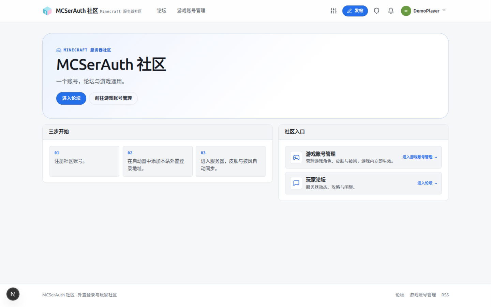
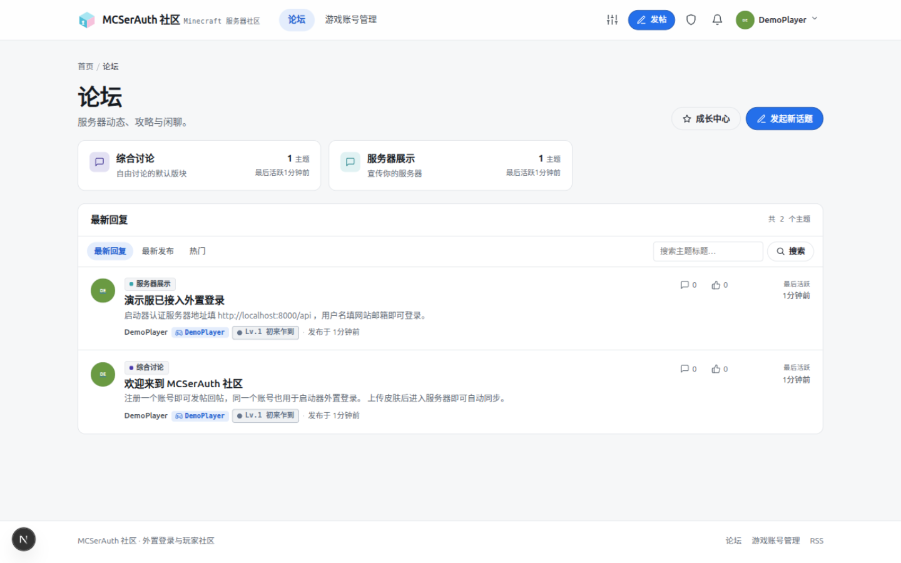
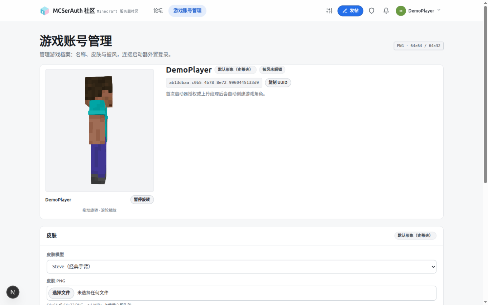
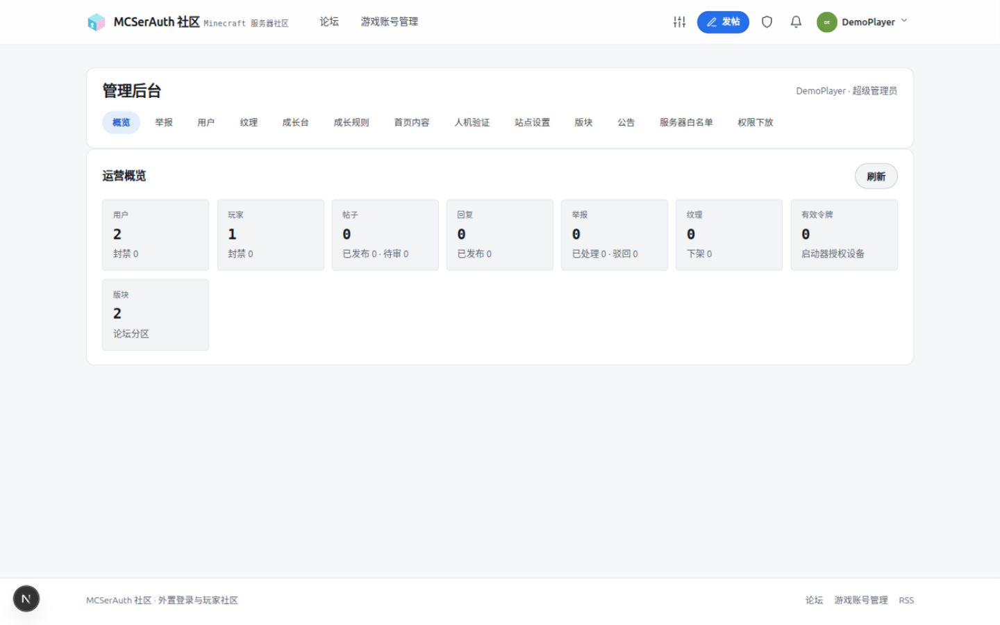
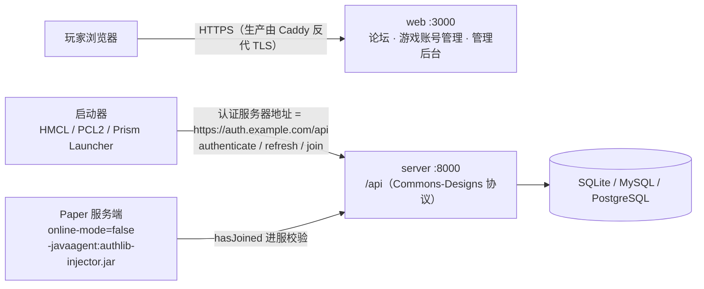

<div align="right">

简体中文 | [English](README.en.md)

</div>

<div align="center">

# MCSerAuth

**面向第三方 Minecraft: Java Edition 服务器的一体化「社区论坛 + 外置登录认证服务」**

认证侧实现 Commons-Designs 服务端协议：
HMCL / PCL2 / Prism Launcher 填一个认证地址即可外置登录；社区侧提供论坛与玩家档案。
两块业务共用同一账号体系，单体部署；默认 SQLite，生产可切换 MySQL 8.0+ / PostgreSQL 16+。

[](https://github.com/Logist1024/MCSerAuth/actions/workflows/ci.yml)
[](https://github.com/Logist1024/MCSerAuth/releases)
[](LICENSE)


| 首页                                                                    | 论坛                                                      |
| ----------------------------------------------------------------------- | --------------------------------------------------------- |
|             |  |
| **游戏账号管理**（皮肤/披风，登录后）                                   | **管理后台**（超级管理员）                                |
|  |    |

_截图来自本地 `pnpm dev`（种子数据 + 演示账号）。_

</div>

## 适合谁 / 不适合谁

**适合谁：**

- 想给玩家一个「注册账号 → 发帖交流 → 传皮肤 → 启动器外置登录 → 进服」完整闭环的中小型 MC 服务器；
- 有一台自己的主机（Linux VPS 或 Windows 面板机）和一个域名，愿意照部署文档复制粘贴命令完成上线；
- 想让论坛账号与游戏外置登录共用同一套账号，玩家改密/找回/换肤只去一个地方。

**不适合谁：**

- 想要 Docker 一键部署或图形化安装面板的——当前只提供裸机部署 runbook 与
  Caddy/pm2/cron/logrotate 配置实例（见 [`docs/deploy.md`](docs/deploy.md)）；
- 需要高清纹理（HD skin / 4K 皮肤）或依赖皮肤签名校验（`signaturePublickey`）的服主——
  只支持原版尺寸纹理，且本实现不提供纹理签名（详见[已知限制](#已知限制)）；
- 需要多实例 / 集群部署的大规模社区——限流、验证码、进程内缓存都是内存态，**只能单进程运行**
  （见 [`docs/deploy.md`](docs/deploy.md) §7）。

## 为什么不用现成方案

- **与 Commons-Designs 的其他实现相比**：多数开源实现是「纯认证 API / 皮肤站」，不包含玩家社区。
  MCSerAuth 把认证、玩家档案、论坛放在同一个账号体系里，一次部署同时拿到两块，玩家只需要注册一次。
- **与「直接把启动器指到公共认证服务器」相比**：那意味着玩家的邮箱、密码、皮肤数据都存在别人那里，
  也没有属于自己的社区阵地。自建 MCSerAuth 后，账号数据、纹理文件、论坛运营全部在你自己的服务器上，
  且启动器侧不需要装任何额外插件（标准 authlib-injector 协议）。

## 接入拓扑



纯文本版（GitHub 之外的查看器用）：

```text
玩家浏览器 ──HTTPS(Caddy)──▶ web :3000   论坛 / 游戏账号管理 / 管理后台
玩家启动器 ──HTTPS(Caddy)──▶ server :8000 /api   认证服务器地址（元数据、authenticate、join）
Paper 服  ──HTTPS(Caddy)──▶ server :8000 /api   hasJoined 校验（online-mode=false + authlib-injector 注入）
                                        └──▶ SQLite / MySQL / PostgreSQL
```

> 进服需要**客户端和 Paper 两侧都注入** authlib-injector（Paper 侧 `online-mode=false` +
> `-javaagent:authlib-injector.jar=https://auth.example.com/api`）。本仓库不含 Paper 插件。

## 技术栈

| 层     | 选型                                                                                     |
| ------ | ---------------------------------------------------------------------------------------- |
| 运行时 | Node.js 22 LTS · pnpm 9 · TypeScript 6（全仓 ESM）                                       |
| 后端   | NestJS 12 · better-auth（账号）· Drizzle ORM · SQLite / MySQL 8.0+ / PostgreSQL 16+      |
| 前端   | Next.js 16 App Router · React 19（只做渲染，业务全在后端）                               |
| 契约   | NestJS Swagger → `docs/openapi.json`；协议暂定字段集中在 `packages/shared/src/protocol/` |
| 质量   | ESLint · Prettier · husky + lint-staged · GitHub Actions                                 |

## 仓库结构

```
MCSerAuth/
├── apps/
│   ├── server/              NestJS 单体后端
│   │   ├── src/config/      env 加载与 zod 校验（单一入口）
│   │   ├── src/common/      过滤器/拦截器/管道/日志脱敏/Swagger 封装
│   │   ├── src/db/          Drizzle 实例 + 单一逻辑模型 + 三套生成 schema（31 张表）
│   │   ├── src/modules/     auth · session · profiles · forum · user · admin · site
│   │   │                    · growth · captcha · mail · maintenance · health
│   │   └── drizzle/         按方言拆分的迁移 SQL（sqlite/ · mysql/ · postgres/）
│   └── web/                 Next.js App Router（渲染层）
├── packages/
│   └── shared/              跨端类型/DTO/错误码/zod schema（单一事实来源）
├── deploy/                  Caddy / pm2 / cron / logrotate 生产配置实例
├── docs/                    部署 / 数据库 / OAuth 集成指南与 OpenAPI 产物
└── .github/workflows/ci.yml
```

## 部署前必读

> 本地试跑可以跳过这一节（开发默认值够用）；**打算给真实玩家用之前，请逐条确认。**

**1. 域名与 HTTPS 是硬前提，不是加分项**

- 网站会话 Cookie 为 `HttpOnly / SameSite=Lax`，`Secure` 属性由 `COOKIE_SECURE` 开启
  （`apps/server/src/modules/auth/auth.instance.ts`），且 `NODE_ENV=production` 时
  `COOKIE_SECURE=true` 是启动强校验——配错进程直接拒绝启动
  （`apps/server/src/config/env.ts`）。这意味着生产部署**必须走 HTTPS**，
  即需要一个域名 + 反代 TLS（`deploy/Caddyfile` 是现成实例，自动签发 Let's Encrypt）。
- `APP_URL`（网站）与 `AUTH_URL`（认证服务）必须属于**同一个注册域**
  （如 `example.com` + `auth.example.com`），否则 better-auth 的 Lax Cookie 跨站不带，
  症状是「登录成功但所有接口 401」。生产环境还**禁止回环地址**（localhost/127.0.0.1），
  否则验证邮件会生成打不开的链接——这也是启动即报错的强校验。
- 在中国大陆提供公网服务，域名需完成 ICP 备案；这是部署环境的要求，与本仓库代码无关，
  但决定了你能不能把 80/443 正常开出来。

**2. 生产环境至少要改这些（详见 [`docs/deploy.md`](docs/deploy.md) §3 的逐项清单）**

| 变量                   | 怎么给                                | 不改会怎样                                                                                      |
| ---------------------- | ------------------------------------- | ----------------------------------------------------------------------------------------------- |
| `BETTER_AUTH_SECRET`   | `openssl rand -base64 48`             | 生产拒绝用开发默认值启动；它还兼作 SMTP 密码的加密密钥                                          |
| `COOKIE_SECURE`        | `true`                                | 生产启动失败                                                                                    |
| `APP_URL` / `AUTH_URL` | 两个真实 https 地址（同注册域）       | 回环地址启动失败；跨注册域 Cookie 失效                                                          |
| `CONSOLE_KEY`          | `openssl rand -base64 32`，或留空禁用 | 留空则 `/console` 不可用（推荐先禁用，需要时再开）                                              |
| `MAIL_PROVIDER`        | 显式设 `smtp`                         | **只填 `SMTP_*` 参数不会切换发件方式**；默认 `console` 只把邮件写进日志，玩家永远收不到验证邮件 |

**3. 责任说明：你要托管玩家的邮箱和密码**

部署这套系统后，玩家的邮箱、密码哈希、皮肤数据都存在**你的服务器**上。密码以
better-auth 的哈希形式存储（明文不可见），但数据库文件、上传目录、备份文件的
物理安全与访问控制完全由你负责——服务器被入侵、备份泄露、面板权限失控，
后果由运营者承担。上线前至少做到：强口令 + 定期 `pnpm db:backup` 并妥善保管备份、
上传目录与数据库不进公开目录、发现安全漏洞按 [`SECURITY.md`](SECURITY.md) 处理。
对玩家，建议在论坛公告或服务条款里如实说明数据的存放位置与泄露风险。

## 快速开始

要求：Node.js 22（`.nvmrc` 已固定）、corepack 可用的 pnpm。

```bash
git clone https://github.com/Logist1024/MCSerAuth.git && cd MCSerAuth
corepack enable                 # 或使用 corepack pnpm <cmd>
pnpm install
cp .env.example apps/server/.env   # 可选：不复制也能跑（有开发默认值）
pnpm db:migrate                    # 建库 + 全部迁移（按 DATABASE_URL 选择方言）
pnpm dev                           # 同时拉起 server(:8000) 与 web(:3000)
```

启动后：

| 地址                                                   | 说明                                                |
| ------------------------------------------------------ | --------------------------------------------------- |
| <http://localhost:3000>                                | 服务器展示页（论坛 / 游戏账号入口）                 |
| <http://localhost:3000/forum>                          | 论坛（版块、主题列表、排序/搜索、发帖、回帖、点赞） |
| <http://localhost:3000/textures>                       | 游戏账号管理（角色 / 皮肤 / 披风 / 登录指南）       |
| <http://localhost:3000/admin>                          | 管理后台（审核员 / 管理员 / 超级管理员）            |
| <http://localhost:3000/sitemap.xml> / `/forum/rss.xml` | SEO 与 RSS                                          |
| <http://localhost:8000/health>                         | 服务探活（统一封装 `{code:0,data}`）                |
| <http://localhost:8000/health/live> · `/health/ready`  | liveness（进程）· readiness（数据库不可用返 503）   |
| <http://localhost:8000/docs>                           | Swagger UI（全部端点契约）                          |
| <http://localhost:8000/docs/json>                      | OpenAPI JSON                                        |

冒烟（注册 → 登录 → 会话）：

```bash
curl -c jar.txt -X POST http://localhost:8000/api/auth/sign-up/email \
  -H 'Content-Type: application/json' \
  -d '{"email":"a@example.com","password":"S3cure!Passw0rd","name":"Tester"}'
curl -b jar.txt http://localhost:8000/api/auth/get-session
```

## 功能一览

完整功能清单（含实现位置与 API 路径）见 **[`docs/features.md`](docs/features.md)**：

| 功能           | 一句话说明                                                                      | 详见                               |
| -------------- | ------------------------------------------------------------------------------- | ---------------------------------- |
| 账号与认证链路 | better-auth 网站会话 + OAuth 授权码/PKCE（basic/player/email 作用域）+ 找回密码 | [features.md §1](docs/features.md) |
| 会话服务       | `joinServer` / `hasJoined`、服务器白名单登记、档案查询                          | [features.md §2](docs/features.md) |
| 皮肤与披风     | 原版尺寸 PNG 上传即生效、3D 预览、短时签名 URL 下发、事后审核                   | [features.md §3](docs/features.md) |
| 启动器直登     | HMCL / PCL2 / XMCL 填 API 根地址 + 网站邮箱即可登录（Yggdrasil 协议）           | [features.md §4](docs/features.md) |
| 论坛           | 版块 / 帖子 / 回复 / 点赞 / 通知 / 举报 / 图片上传 / 游客浏览                   | [features.md §5](docs/features.md) |
| 管理与权限     | 四级角色 + 9 项能力下放 + `/console` 密钥超级后台 + 站点外观                    | [features.md §5](docs/features.md) |
| 社区成长       | 等级 / 称号 / 签到 / 积分 / 商店 / 打赏 / 首页 Banner                           | [features.md §6](docs/features.md) |
| 人机验证       | 内置 SVG 算术题或 Cloudflare Turnstile / hCaptcha，生产默认开启                 | [features.md §6](docs/features.md) |

## 常用命令

根目录执行（`package.json` → `scripts`）：

| 命令                                | 作用                                     |
| ----------------------------------- | ---------------------------------------- |
| `pnpm dev`                          | 并行启动 server + web（先构建 shared）   |
| `pnpm build`                        | shared → server → web 全量构建           |
| `pnpm lint` / `pnpm lint:fix`       | 全仓 ESLint                              |
| `pnpm format` / `pnpm format:check` | Prettier                                 |
| `pnpm typecheck`                    | 全仓 `tsc --noEmit`                      |
| `pnpm test` / `pnpm test:coverage`  | Vitest（server + web）                   |
| `pnpm db:generate`                  | 生成三套 schema + SQLite/MySQL/PG 迁移   |
| `pnpm db:generate:sqlite`           | 只生成 SQLite 迁移                       |
| `pnpm db:check`                     | 校验生成物与 `model.ts` 同步（CI）       |
| `pnpm db:migrate`                   | 按 `DATABASE_URL` 应用对应方言迁移       |
| `pnpm db:seed`                      | 幂等写入占位用户/版块/站点设置           |
| `pnpm db:copy-data`                 | 跨方言一次性复制（含 SQLite 目标）       |
| `pnpm db:backup`                    | 备份当前库（三库；`--dry-run` 打印计划） |
| `pnpm db:studio`                    | Drizzle Studio 浏览数据                  |
| `pnpm admin:grant <email> [role]`   | 授予 user/reviewer/admin/superadmin      |
| `pnpm openapi:export`               | 构建并刷新 `docs/openapi.json`           |

## 环境变量

全部变量在 `apps/server/src/config/env.ts` 中 zod 校验，启动即失败、不做运行期兜底。
模板见根目录 [`.env.example`](.env.example)（复制到 `apps/server/.env`）。

| 变量                              | 默认（开发）                      | 说明                                                                                          |
| --------------------------------- | --------------------------------- | --------------------------------------------------------------------------------------------- |
| `NODE_ENV`                        | `development`                     | `production` 时强制校验 secret、Cookie 与非回环 URL                                           |
| `PORT`                            | `8000`                            | server 端口                                                                                   |
| `LOG_LEVEL`                       | `debug`（模板）                   | pino 级别；敏感字段自动脱敏                                                                   |
| `APP_URL` / `AUTH_URL`            | `http://localhost:3000` / `:8000` | 站点域 / 认证域；CORS 与 OriginGuard 白名单来源；生产禁止回环地址（启动即报错）               |
| `COOKIE_SECURE`                   | `false`                           | 生产必须 `true`（Secure/HttpOnly/SameSite=Lax）                                               |
| `BETTER_AUTH_SECRET`              | 开发默认值                        | 生产必填（≥32 字符），`openssl rand -base64 48`                                               |
| `OAUTH_ACCESS_TOKEN_TTL_SECONDS`  | `2592000`                         | 启动器 access token 有效期（秒，默认 30 天）                                                  |
| `OAUTH_REFRESH_TOKEN_TTL_SECONDS` | `5184000`                         | refresh token 绝对有效期（秒，默认 60 天）                                                    |
| `OAUTH_AUTH_CODE_TTL_SECONDS`     | `300`                             | 授权码有效期（秒，单次使用）                                                                  |
| `SESSION_JOIN_TTL_SECONDS`        | `300`                             | joinServer 会话可被 hasJoined 兑换的窗口（秒）                                                |
| `TEXTURE_URL_TTL_SECONDS`         | `300`                             | 签名纹理 URL 有效期（秒）                                                                     |
| `DATABASE_URL`                    | `./data/mcserauth.db`             | SQLite 路径或 `mysql://` / `postgres://` 连接串                                               |
| `DB_DIALECT`                      | 自动识别                          | 可选覆盖，必须与 `DATABASE_URL` 协议一致                                                      |
| `DB_POOL_MIN` / `DB_POOL_MAX`     | `0` / `10`                        | MySQL/PostgreSQL 连接池（SQLite 忽略）                                                        |
| `DB_CONNECTION_TIMEOUT_MS`        | `10000`                           | 建立连接超时（毫秒）                                                                          |
| `DB_IDLE_TIMEOUT_MS`              | `30000`                           | 空闲连接回收时间（毫秒）                                                                      |
| `DB_SSL`                          | `false`                           | MySQL/PostgreSQL 是否强制 TLS                                                                 |
| `UPLOAD_DIR`                      | `./data/uploads`                  | 皮肤/披风 PNG 存储目录                                                                        |
| `MAIL_*` / `SMTP_*`               | 占位                              | 默认发件配置；超级后台可覆盖（密码加密存储）。`console` 只写日志不投递，生产启动时输出 `warn` |
| `CONSOLE_KEY`                     | 空（禁用）                        | 超级后台密钥（≥16 字符），空则 `/console` 不可用                                              |
| `CONSOLE_SESSION_TTL_SECONDS`     | `28800`                           | 超级后台会话有效期（秒）                                                                      |

测试用 `TEST_DATABASE_URL` 切换到 MySQL/PostgreSQL；数据复制用
`SOURCE_DATABASE_URL` / `TARGET_DATABASE_URL`（脚本变量，不由 server 读取），
见 [`docs/database.md`](docs/database.md)。

web 侧变量：`NEXT_PUBLIC_API_BASE_URL`（默认 `http://localhost:8000`）、
`NEXT_PUBLIC_SITE_URL`（默认 `http://localhost:3000`，用于 sitemap/robots）与
`CONSOLE_PATH`（可选，把特殊路径重写到 `/console`，构建/启动时读取），
模板见 [`apps/web/.env.example`](apps/web/.env.example)，复制为 `apps/web/.env.local` 生效。

## 数据层

- **三库支持**：SQLite（默认，WAL + 外键 + `busy_timeout`）、MySQL 8.0+、PostgreSQL 16+。
  方言由 `DATABASE_URL` 自动识别；完整配置、迁移与运维说明见
  [`docs/database.md`](docs/database.md)。三方言各一份 31 表 `0000` 基线（旧 SQLite 12 版
  历史已移除），后续变更以增量迁移追加。
- **单一逻辑模型**：31 张表在 `apps/server/src/db/schema/model.ts` 声明一次，
  `scripts/generate-schema.ts` 生成 SQLite/MySQL/PostgreSQL 三套 Drizzle schema 与运行时
  facade。改表只改 `model.ts`，然后 `pnpm db:generate`；生成文件禁止手改。
- **跨方言 helper**：业务代码通过 `DbService` 的 `insertReturning` / `updateReturning` /
  `insertIgnore` / `upsert` / `transaction` 访问数据库，避免散落方言分支；MySQL 无
  `RETURNING`、无部分唯一索引，`skin.active_slot` 判别列负责“每人每类仅一条 active”。
- 31 张表覆盖用户与账号、玩家与令牌、OAuth 授权码与注册客户端/授权记录、
  游戏会话、服务器白名单、皮肤披风、论坛版块/帖子/回复/投票/举报/通知/审计日志、
  站点配置，以及成长体系的 `user_progress`/`daily_checkin`/`point_transaction`/
  `title`/`user_title`/`title_application`/`banner`、`captcha_challenge`、
  权限下放的 `user_permission`）；better-auth 的 `session/account/verification`
  纳入 Drizzle 声明并由其维护。
- 论坛支持嵌套版块、置顶/精华/锁定/软删除、实时回复数与点赞数；通知含系统/审核正文列。
- 纹理文件存于 `UPLOAD_DIR`，按 `textures/{kind}/{sha256}.png` 内容寻址；
  帖子图片存于 `UPLOAD_DIR/forum/{sha256}.{ext}`。
  `skin` 表按 `(player_uuid, kind, sha256)` 去重，同一类型仅一条 `is_active`。
- **所有建表改动必须走 `pnpm db:generate` 生成三套迁移**，禁止手改库文件或运行时同步。
- 迁移前先跑 `pnpm db:backup`：按 `DATABASE_URL` 选引擎，三库统一写入
  `apps/server/data/backups/`（MySQL/PostgreSQL 包装 `mysqldump` / `pg_dump`，
  凭据只经环境变量传递、不进命令行），详见数据库指南与
  [`docs/deploy.md`](docs/deploy.md)。
- 恢复步骤：停止 server → 再备份当前库 → 用备份文件覆盖目标库 → `pnpm db:migrate` 确认版本。
- 从 SQLite 切换到 MySQL/PostgreSQL：先对目标执行 `pnpm db:migrate`，再用
  `pnpm db:copy-data -- --truncate` 复制并校验数据。
- 昵称 30 天保留记录在 `nickname_reservation`；改名事务内写入，启动时幂等回填。
- 上传配额按 `upload_usage(user_id, kind, day, count)` 按自然日计数；维护任务每小时清理过期授权码、游戏会话、过期会话与 90 天前的配额行。
- 启动器令牌记录 `device_name` / `ip` / `expires_at` / `last_used_at` / `revoked_at`（令牌本体只存哈希）。
  玩家侧「已授权设备」页与 `/api/user/tokens` **已于 2026-10-25 移除**，当前吊销入口只有启动器侧
  `POST /api/authserver/invalidate`。

## API 契约

- 非协议端点统一封装：成功 `{ code: 0, data }`，失败 `{ code, message }`（错误码见 `packages/shared/src/errors.ts`）。
- 非协议写接口校验 `Origin`/`Referer`（`APP_URL`/`AUTH_URL` 白名单），跨站请求返回 403；认证与写接口有进程内限流（429）。
- 帖子详情回复分页：`replyPage` / `replyPageSize`（默认 1/20，上限 50），响应含 `replyTotal`。
- 通知列表分页（默认 20），另有 `GET /api/forum/notifications/unread-count` 供角标使用。
- 公共版块/帖子列表带 15 秒 HTTP 缓存；论坛列表页 Next 侧 `revalidate = 30`。
- **Commons-Designs 协议端点不套封装**，返回协议原生形状（错误为 `{ error, errorMessage }`）。
  已实现全部登记端点：`oauth/*`、`user/profiles/me`、`session/*`、`profiles/*`、`minecraft/profile/*`。
- 论坛、账号资料与管理端使用统一封装 + better-auth Cookie 会话：
  `/api/forum/*`、`/api/user/*`、`/api/users/{id}`、`/api/admin/*`。
- 启动器令牌只存哈希、授权码单次使用；`/user/profiles/me` 与纹理接口同时接受 Bearer 令牌与网站 Cookie。
- 纹理上传经 sharp 校验后立即生效（仅原版尺寸，不支持高清）；审核员可事后下架，
  当前纹理以短时签名 URL 下发；删除当前纹理回退默认形象。
- 注册 OAuth 客户端：管理端 `/api/admin/oauth-clients`（列表/创建/更新/密钥重置/删除，
  需 `oauth.clients` 能力）+ 作用域 userinfo `GET|POST /api/oauth/userinfo`（按令牌 scope
  过滤账号/玩家/邮箱声明）；接入方指南见 [`docs/oauth-integration.md`](docs/oauth-integration.md)。
- 契约产物：[`docs/openapi.json`](docs/openapi.json)（`pnpm openapi:export` 刷新）。

## 开发约定

- 提交遵循 [Conventional Commits](https://www.conventionalcommits.org/)（`feat:` `fix:` `docs:` `chore:` …）。
- pre-commit 自动跑 lint-staged（ESLint + Prettier，见 `.husky/pre-commit`）。
- 跨端 DTO/枚举/错误码只写在 `packages/shared`，应用内不得复制类型。
- CI（`.github/workflows/ci.yml`）：`quality`（lint → format:check → typecheck → `db:check`
  → build）+ `test-sqlite` + `test-databases`（MySQL 8.0 / PostgreSQL 16 service container 矩阵）。
  两个测试 job 都先对空库执行迁移冒烟，再跑同一套 server 测试，最后走 `db:seed` →
  `db:copy-data --truncate`（行数 + 全行 SHA-256 校验）→ 目标库幂等重跑。

## 文档导航

| 文档                                                     | 内容                                                                       |
| -------------------------------------------------------- | -------------------------------------------------------------------------- |
| [CONTRIBUTING.md](CONTRIBUTING.md)                       | 参与开发入口：环境、提交与 PR 约定、DoD、契约纪律                          |
| [`docs/features.md`](docs/features.md)                   | 完整功能清单：认证/会话/纹理/论坛/成长体系，含实现位置与 API 路径          |
| [SECURITY.md](SECURITY.md)                               | 安全政策：漏洞私密报告渠道与响应预期                                       |
| [`docs/database.md`](docs/database.md)                   | 三库配置、schema 工作流、迁移/复制/备份                                    |
| [`docs/deploy.md`](docs/deploy.md)                       | 生产部署 runbook：VPS 上线 checklist、生产 `.env` 逐项清单、备份与恢复演练 |
| [`docs/security.md`](docs/security.md)                   | 安全基线：CSP、安全响应头、审计豁免与哈希                                  |
| [`docs/oauth-integration.md`](docs/oauth-integration.md) | 姊妹服务 OAuth SSO 接入指南：客户端注册、scope、PKCE                       |
| [`docs/openapi.json`](docs/openapi.json)                 | OpenAPI 契约产物（`pnpm openapi:export`）                                  |

## License

[MIT](LICENSE)
